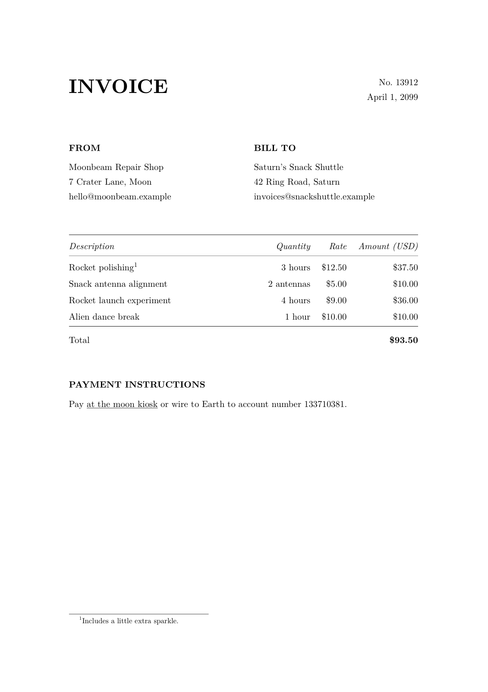

# mkinv - make invoice

Generate beautiful PDF invoices from YAML with Pandoc and LaTeX.



## Setup

On macOS, install [Homebrew](https://brew.sh). Install Pandoc and BasicTeX:

```sh
brew install pandoc
brew install --cask basictex # or your XeLaTeX distribution of choice
```

Install the required TeX packages:

```sh
tlmgr update --self
tlmgr install fontspec geometry tools booktabs hyperref lm
```

## Usage

Pass YAML through stdin or file:

```sh
./mkinv > invoice.pdf <<'YAML'
number: "13912"
date: "2099-04-01"
currency: "USD"

sender:
  name: "Moonbeam Repair Shop"
  address: "7 Crater Lane, Moon"
  email: "hello@moonbeam.example"
  registration_number: "MOON-12345"

client:
  name: "Saturn's Snack Shuttle"
  address: "42 Ring Road, Saturn"
  email: "invoices@snackshuttle.example"
  registration_number: "SATURN-67890"

items:
  - name: "Rocket polishing"
    quantity: "3 hours"
    rate: 12.50
    note: "Includes a little extra sparkle."
  - name: "Snack antenna alignment"
    quantity: "2 antennas"
    rate: 5
  - name: "Rocket launch experiment"
    quantity: "4 hours"
    rate: 9
  - name: "Alien dance break"
    quantity: "1 hour"
    rate: 10

notes: "Pay [at the moon kiosk](https://payments.example/moon-001) or wire to Earth to account number 133710381."
YAML
```

You can also read YAML from a file or a pipe:

```sh
./bin/mkinv examples/example.yaml > invoice.pdf
```

## Invoice fields

- Required fields: `number`, `date`, `currency`, `sender`, `client`, and `items`.
- Both `sender` and `client` require `name`, `address`, and `email`. They can also include `registration_number`.
- Use `YYYY-MM-DD` for `date`. The PDF displays it as `April 1, 2099`.
- Each item requires `name`, `quantity`, and `rate`.
- `quantity` must start with a nonnegative number. You can include a unit, such as `"3 hours"` or `"2 antennas"`.
- `rate` must be a nonnegative number. Do not include a currency symbol.
- An item's optional `note` appears as a numbered footnote.
- Optional `notes` appear under **PAYMENT INSTRUCTIONS**. Markdown links and bare URLs become clickable links.
